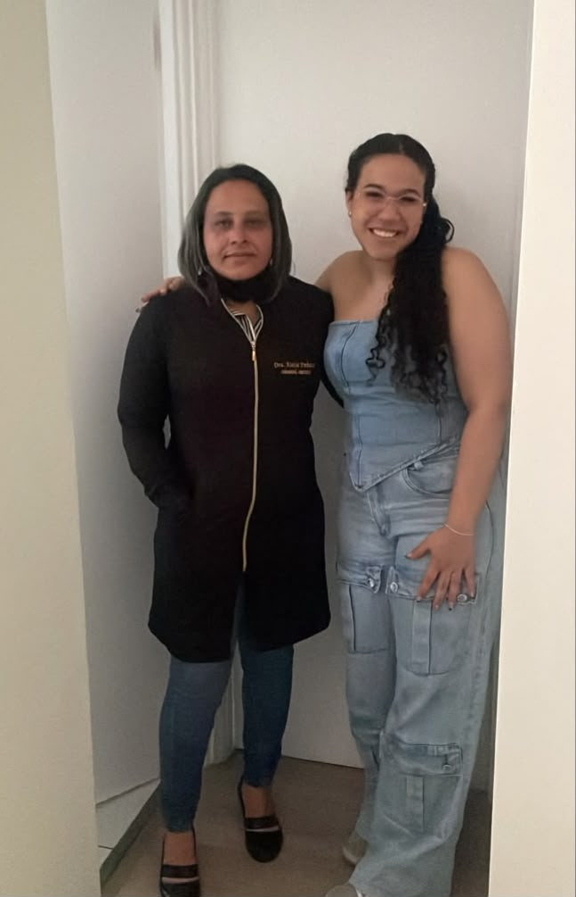
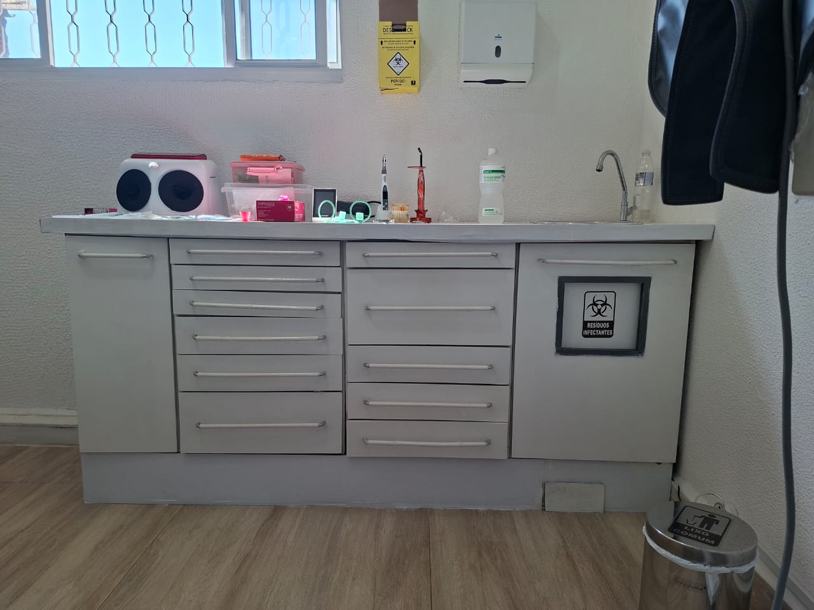
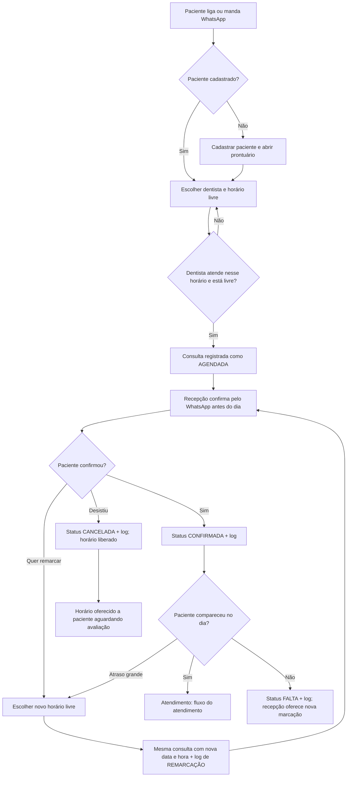
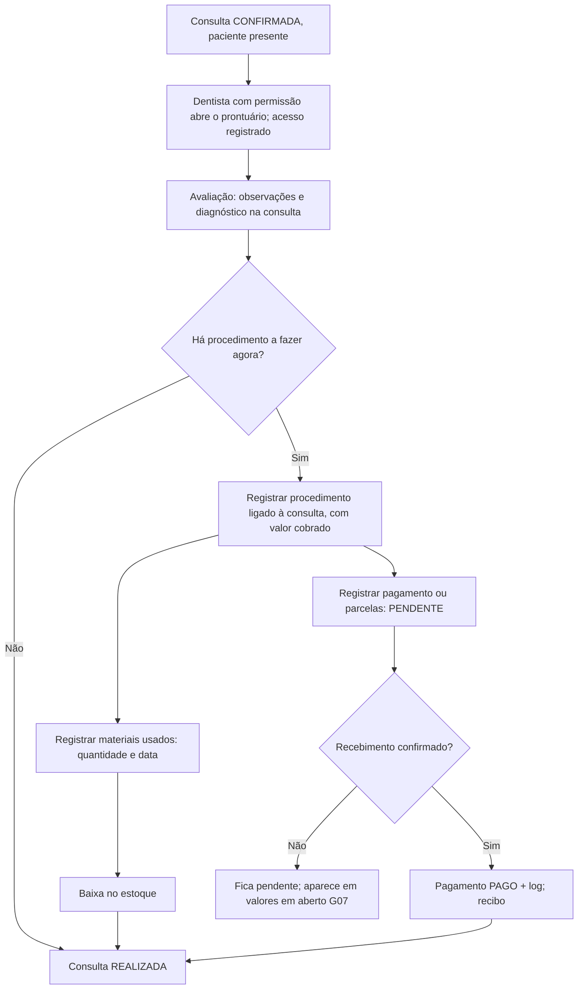
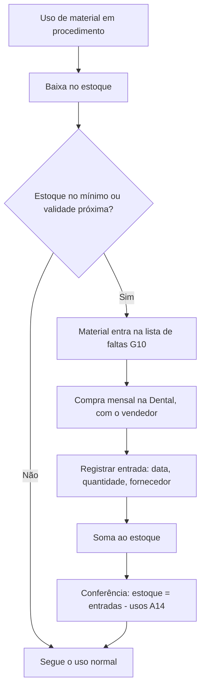
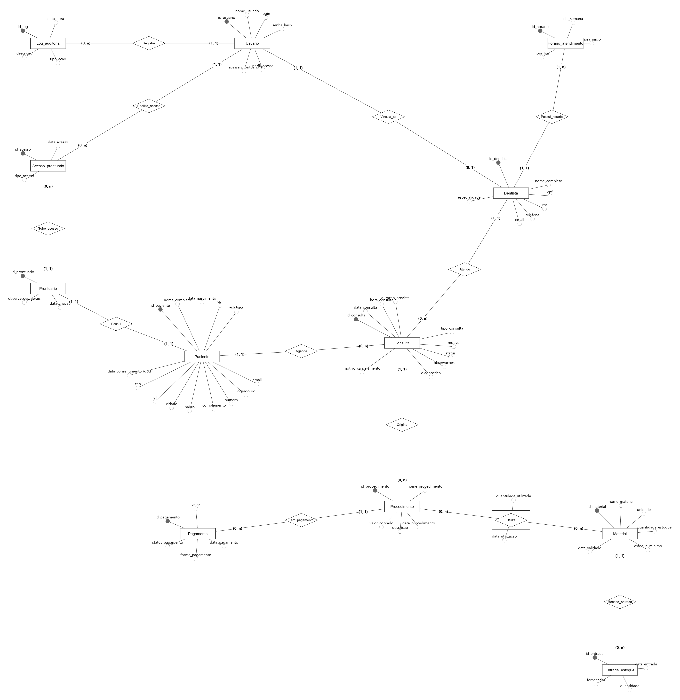
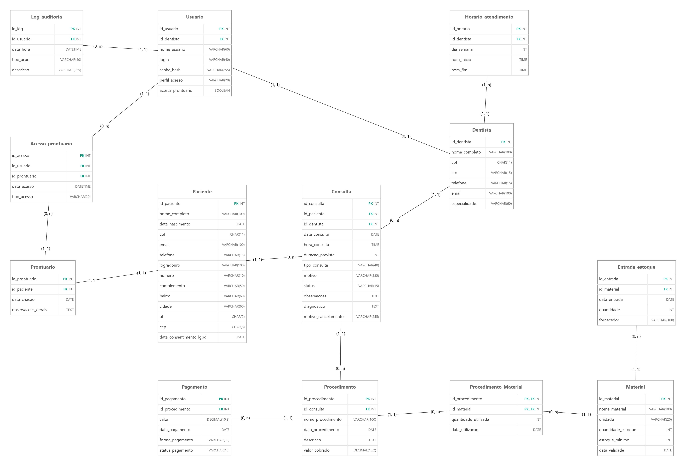

# E.K. Consultório Odontológico — Entrega 2

### Modelo lógico, implementação SQL e apresentação final

**Arquivos do trabalho**

| Artefato | Arquivo |
| :---- | :---- |
| Relatório técnico | este `README.md` |
| DER conceitual | [`diagramas/DER_conceitual.png`](DER_conceitual.png) |
| Modelo lógico | [`diagramas/modelo_logico.png`](modelo_logico.png) |
| Script SQL completo (com a massa de dados) | [`docs/script.sql`](script.sql) |
| Dicionário de dados (turma GTI, Markdown) | [`docs/dicionario_de_dados.md`](dicionario_de_dados.md) |
| Levantamento | [`levantamento/levantamento.md`](levantamento.md) |
| Entrevista (documento) | [`levantamento/entrevista_EK_consultorio_odontologico.pdf`](entrevista_EK_consultorio_odontologico.pdf) |
| Evidências (fotos e prints) | [`evidencias/`](./) — foto da visita, foto do consultório e prints do WhatsApp com a responsável |
| Documentos de apoio | [justificativa geral](Justificativa_Geral_do_Projeto.md), [justificativas técnicas](Justificativas_Tecnicas_Modelagem.md), [PKs e FKs](Identificacao_PKs_FKs.md), [arquitetura de BI e IA](Proposta_Arquitetura_Analitica_BI_IA.md) |

---

## 1. Relatório técnico final

### Integrantes

| Nome completo do aluno | RGM | Usuário do GitHub |
| :---- | :---- | :---- |
| Diogo da Silva Alves | 47236752 | [diogodasilvaalves02-cmd](https://github.com/diogodasilvaalves02-cmd) |
| Julia Otsubo de Jesus | 47538317 | [juliaotsubo](https://github.com/juliaotsubo) |
| Karine dos Santos Nogueira | 47430991 | [karinedossantosnogueira](https://github.com/karinedossantosnogueira) |
| Matheus Guimarães Santos | 49081144 | [matheusgsantos1331-blip](https://github.com/matheusgsantos1331-blip) |
| Vinicius Agnoletto da Silva | 49604741 | [viniciusagnoletto22-hub](https://github.com/viniciusagnoletto22-hub) |

### 1.1 Revisão do modelo conceitual

**Caso A — mesma organização da Entrega 1.**

#### Caracterização da organização

- **Nome e natureza:** E.K. Consultório Odontológico, consultório odontológico particular de pequeno porte, com fins lucrativos, que atua como pessoa física e é administrado diretamente pelas cirurgiãs-dentistas responsáveis. Atende só particular, sem planos odontológicos.
- **Endereço e contato:** Avenida Vital Brasil, 712 — Butantã, São Paulo/SP · telefone/WhatsApp +55 11 95311-4998 · consultorioodontoek@gmail.com · Instagram @ek_odontologia · [localização no Google Maps](https://www.google.com.br/maps/@-23.5704211,-46.7109521,729a,90y,354.68h,81.55t/data=!3m7!1e1!3m5!1sZQ7wLq3m06yJRXbGsnQGhA!2e0!6shttps:%2F%2Fstreetviewpixels-pa.googleapis.com%2Fv1%2Fthumbnail%3Fcb_client%3Dmaps_sv.tactile%26w%3D900%26h%3D600%26pitch%3D8.450000000000003%26panoid%3DZQ7wLq3m06yJRXbGsnQGhA%26yaw%3D354.68!7i16384!8i8192?hl=pt-BR&entry=ttu&g_ep=EgoyMDI2MDkyMS4wIKXMDSoASAFQAw%3D%3D).
- **Responsáveis:** Dra. Kátia Pinheiro e Dra. Elielma Gomes · quem atendeu o grupo: **Dra. Kátia Pinheiro**, +55 11 95311-4998 (WhatsApp da clínica).
- **Contexto e porte:** 3 cirurgiãs-dentistas (Clínica Geral) e 1 funcionária de atendimento telefônico. Atendimento de segunda a sábado, fechado em feriados nacionais. Cerca de 30 pacientes cadastrados (contando os que já terminaram o tratamento), dos quais 7 a 8 retornam com frequência, o que dá em torno de 2 a 3 atendimentos por dia. Na Entrega 1 a clínica tinha informado de 5 a 9 pacientes por dia; na entrevista de 02/11/2026 esse número foi revisto, e o projeto passou a usar o volume real. Compras de material mensais. Consultas de 20 min (profilaxia) a 30–40 min (canal). Valores de referência: profilaxia cerca de R$ 250; restauração de R$ 300 a R$ 350. Pagamento em dinheiro ou cartão, parcelado em até 3 vezes.
- **Justificativa da escolha:** organização real, com acesso garantido às responsáveis, em que a informação (histórico clínico, agenda, procedimentos, materiais e pagamentos) é central e inclui dados sensíveis de saúde. Nenhum integrante do grupo tem vínculo de trabalho ou familiar com a clínica.

**Problemas e necessidades identificados**

| Código | Problema de gestão de informações |
|---|---|
| P1 | Organização dos agendamentos e horários das consultas (inclui confirmação e faltas) |
| P2 | Controle dos dados dos pacientes |
| P3 | Organização dos prontuários e históricos |
| P4 | Registro e acompanhamento dos procedimentos realizados |
| P5 | Controle de pagamentos e pendências |
| P6 | Controle dos materiais usados nos procedimentos |
| P7 | Controle do estoque e das compras de materiais |
| P8 | Organização de cancelamentos e remarcações |
| P9 | Controle dos acessos às informações dos prontuários |

**Escopo do sistema:** o banco reúne todos os dados da clínica: pacientes, prontuários, dentistas e horários, usuários e permissões, agenda, atendimentos, procedimentos, pagamentos, materiais, compras e auditoria.

#### Relato da entrevista

- **Quem:** Dra. Kátia Pinheiro, cirurgiã-dentista e responsável pelo consultório · visita presencial feita por Karine dos Santos Nogueira; os demais integrantes participaram da conversa com a Dra. Kátia pelo WhatsApp.
- **Quando e onde:** 02/11/2026, no consultório (Av. Vital Brasil, 712).
- **Comprovação:** foto da visita no consultório, com a Dra. Kátia e a Karine ([`evidencias/foto_visita_dra_katia_e_karine.jpg`](foto_visita_dra_katia_e_karine.jpg)), foto do ambiente de atendimento ([`evidencias/foto_consultorio_biosseguranca.jpg`](foto_consultorio_biosseguranca.jpg)) e prints da conversa de 01/11/2026 pelo WhatsApp, em que a Dra. Kátia respondeu às perguntas do grupo por áudio e concordou com a visita e as fotos ([`evidencias/`](print_whatsapp_perguntas_01-11.jpg)).

   
- **Resumo do levantamento** (completo em [`levantamento/levantamento.md`](levantamento.md)):
  - cerca de 30 pacientes cadastrados, 7 a 8 recorrentes; anamnese, avaliação e orçamento ficam no prontuário;
  - valores definidos pelas Dras. Kátia e Elielma, que são também as únicas com acesso aos prontuários;
  - materiais usados são anotados; compras mensais a partir de uma lista do que está em falta, na Dental, por contato com o vendedor;
  - consultas confirmadas pelo WhatsApp; falta ou atraso grande geram remarcação; motivo de cancelamento não é registrado;
  - atende de segunda a sábado (horários exatos a confirmar); Clínica Geral; dinheiro e cartão em até 3×;
  - termo de consentimento assinado em todos os procedimentos; menores a partir de 8 anos, com responsável;
  - prontuários guardados por 1 ano (prazo abaixo do exigido pelo CFO — ver RN47).
- **Achados da observação no local** (feitos pela Karine na visita, separados das respostas da entrevista):
  - a agenda é controlada **em papel**, o que confirma o problema P1 e a necessidade de confirmação, faltas e remarcações no sistema;
  - as fichas dos pacientes ficam **com a doutora**, o que confirma o acesso restrito aos prontuários (RN48);
  - o estoque fica num **espaço exclusivo** para os materiais, separado do atendimento (base para Material e Entrada_estoque);
  - os produtos e utensílios são **higienizados e descartados de forma correta**: é rotina física de biossegurança, sem dado de gestão, o que reforça a decisão de não modelar a esterilização.

### Processos de negócio

Os processos abaixo foram montados a partir da caracterização da organização, do levantamento da Entrega 1, das respostas da responsável (mensagem de 01/11/2026), do DER, do modelo lógico e das regras de negócio.

**Legenda da fonte de cada informação:**
- **(C)** confirmado pela clínica em 01/11/2026.
- **(E1)** vem do levantamento da Entrega 1.
- **(\*)** inferido pelo grupo e ainda não confirmado com a responsável.

#### Processos mapeados na organização

| # | Processo | Como funciona (com os dados envolvidos) | Quem executa | Entidades |
|---|---|---|---|---|
| 1 | Cadastro e atualização de pacientes | Registra `nome_completo`, `data_nascimento`, `cpf` (quando houver), `telefone`, `email` e endereço (`logradouro`, `numero`, `complemento`, `bairro`, `cidade`, `uf`, `cep`). Antes de cadastrar, verifica se o paciente já existe, por CPF ou por nome e data de nascimento, para evitar duplicidade (RN01 a RN03). Quando o paciente assina o termo de consentimento para uso dos dados de saúde, registra `data_consentimento_lgpd`, que deve ser anterior ao primeiro atendimento (RN46). | Funcionária de atendimento e dentistas (\*) | Paciente |
| 2 | Abertura do prontuário | O prontuário é aberto junto com o cadastro. Cada paciente tem exatamente um, com `data_criacao` e `observacoes_gerais` (RN05). | Dentistas (\*) | Prontuario |
| 3 | Cadastro de dentistas e horários de atendimento | Registra `nome_completo`, `cpf`, `cro`, `telefone`, `email` e `especialidade`, mais os períodos de atendimento (`dia_semana`, `hora_inicio`, `hora_fim`). A clínica atende de segunda a sábado (C). RN04 e RN42. | Dentistas, na gestão do consultório (\*) | Dentista, Horario_atendimento |
| 4 | Gestão de usuários e perfis de acesso | Cada pessoa tem `login` individual, `senha_hash`, `perfil_acesso` (recepção ou dentista) e `acessa_prontuario`. Cada dentista tem uma conta, e a recepção pode ter conta sem ficha de dentista (RN06, RN07, RN29 a RN31). Só duas das três dentistas acessam prontuário (C); o registro clínico da terceira é transcrito por uma delas (RN48). | Dentistas, na gestão do consultório (\*) | Usuario |
| 5 | Agendamento de consultas | Em geral por telefone (E1). Registra `id_paciente`, `id_dentista`, `data_consulta`, `hora_consulta`, `duracao_prevista`, `tipo_consulta`, `motivo` e `status` "agendada". Confere a disponibilidade do dentista e impede sobreposição de horários (RN08 a RN10). | Funcionária de atendimento (E1) | Consulta |
| 5a | Confirmação de consultas | Antes do dia, a funcionária liga ou manda WhatsApp para o paciente e, se ele confirmar, muda o `status` para "confirmada". A ação fica em Log_auditoria (`CONFIRMACAO`) (RN49). | Funcionária de atendimento (C) | Consulta, Log_auditoria |
| 5b | Registro de faltas | Se o paciente não comparece, a consulta passa a "falta" (não é apagada nem cancelada), e a ação fica em Log_auditoria (`FALTA`). A taxa de faltas é acompanhada por mês (G19, RN50). | Funcionária de atendimento (C) | Consulta, Log_auditoria |
| 6 | Cancelamento e remarcação | O cancelamento muda o `status` para "cancelada" e guarda `motivo_cancelamento`, sem apagar o registro. A remarcação confere o novo horário, libera o anterior e fica registrada com usuário, data e hora (RN12 a RN14). O fluxograma está no repositório. | Funcionária de atendimento (E1) | Consulta, Log_auditoria |
| 7 | Avaliação do paciente e definição do tratamento | Antes de iniciar os procedimentos, o dentista avalia o paciente para definir os tratamentos necessários e seus valores (C). A avaliação é registrada na consulta (`observacoes` e `diagnostico`), e o valor definido vai em `valor_cobrado` do procedimento (RN45). | Dentistas (C) | Consulta, Procedimento |
| 8 | Realização do atendimento e registro clínico | A consulta passa a "realizada" quando o atendimento ocorre. O dentista registra `observacoes` e `diagnostico` (RN15, RN17, RN21). | Dentistas (\*) | Consulta, Prontuario |
| 9 | Registro de procedimentos | Registra a consulta em que o procedimento foi feito (`id_consulta`, obrigatório: todo procedimento acontece em uma consulta, C), `nome_procedimento`, `data_procedimento`, `descricao` e `valor_cobrado`. Paciente e dentista vêm da consulta (RN18, RN19). | Dentistas (\*) | Procedimento, Consulta |
| 10 | Registro de materiais utilizados | Para cada procedimento, anota quais materiais foram usados, `quantidade_utilizada` (na unidade de consumo: par, unidade, tubete, grama, mL) e `data_utilizacao`, e dá baixa no estoque (RN37, RN38). Atende ao problema P6. | Dentistas (\*) | Procedimento_Material, Material |
| 11 | Controle de estoque de materiais | Acompanha `quantidade_estoque`, `estoque_minimo` e `data_validade`, para identificar reposição e vencimentos (RN36, RN39, RN40). O estoque deve bater com entradas − usos (A14, RN51). Atende ao problema P7. | Dentistas, na gestão do consultório (\*) | Material |
| 11a | Compra de materiais | Os materiais são comprados na Dental, por contato com o vendedor (C). Cada compra recebida é registrada com `data_entrada`, `quantidade` e `fornecedor` e somada ao estoque (RN51). Compras por mês aparecem na G20. | Dentistas, na gestão do consultório (C) | Entrada_estoque, Material |
| 12 | Controle de pagamentos e pendências | Cada pagamento é ligado a um procedimento, com `valor`, `data_pagamento`, `forma_pagamento` e `status_pagamento` (pendente ou pago). Um procedimento pode ter vários pagamentos, o que permite parcelamento (RN23 a RN26). O atendimento é só particular, sem planos de saúde (C). Valores de referência: profilaxia cerca de R$ 250 e restauração de R$ 300 a R$ 350 (C). | Dentistas e funcionária (\*) | Pagamento |
| 13 | Emissão de comprovante | Só para pagamento confirmado como recebido, identificando a transação (RN27). | Funcionária de atendimento (\*) | Pagamento |
| 14 | Consulta ao histórico do paciente | Permite ver as consultas e os procedimentos anteriores, respeitando as permissões (RN20). | Dentistas e recepção, conforme o perfil (\*) | Paciente, Consulta, Procedimento |
| 15 | Controle de acesso aos prontuários | Só usuários com `acessa_prontuario` abrem prontuário (RN48). O sistema registra quem abriu ou alterou um prontuário, quando e de que tipo foi o acesso (RN41). O prontuário é guardado por no mínimo 20 anos (CFO, RN47). Atende ao problema P9. | Automático (sistema) | Acesso_prontuario, Usuario |
| 16 | Auditoria de ações | Registra ações relevantes (confirmações, faltas, cancelamentos, remarcações, confirmações de pagamento) com usuário, data e hora, tipo e descrição (RN32, RN33). | Automático (sistema) | Log_auditoria |
| 17 | Acompanhamento gerencial | Consultas gerenciais G01 a G20 sobre agenda, faltas, pacientes, procedimentos, financeiro, materiais, compras, cancelamentos e acessos, e consultas de auditoria A01 a A14. | Dentistas, na gestão do consultório (\*) | Todas |

#### Fluxogramas dos processos principais

Os três fluxos abaixo mostram como os processos se integram. O GitHub desenha os diagramas a partir do código Mermaid.

**Agenda: agendamento, confirmação, atendimento, falta, cancelamento e remarcação** (processos 5, 5a, 5b e 6)

**Atendimento: avaliação, procedimento, materiais e pagamento** (processos 7 a 13)

**Estoque: uso, conferência e compra mensal** (processos 10, 11 e 11a)

#### Processos típicos de consultório odontológico e uso de IA

Foi usada uma ferramenta de IA para levantar o que consultórios odontológicos de pequeno porte costumam fazer. Os processos típicos são: cadastro de pacientes, agendamento e confirmação de consultas, anamnese e prontuário clínico, odontograma e plano de tratamento, orçamento, execução de procedimentos, controle de materiais e estoque, compras de fornecedores, cobrança e recebimento, convênios, emissão de recibos e notas, esterilização e biossegurança, e laboratório protético. Cada um foi comparado com a realidade do E.K.; o resultado está nas duas tabelas desta seção. O uso de IA é registrado na seção 6 do relatório.

#### Processos prováveis não incluídos

| Processo comum | Situação e por que ficou de fora |
|---|---|
| Convênios e planos odontológicos | A clínica atende apenas particular e não trabalha com planos de saúde (C). Regra RN44. |
| Cadastro de fornecedores | A compra entrou no modelo (processo 11a), mas sem cadastro de fornecedores: a clínica compra tudo na mesma loja (C), então o fornecedor é só um texto na entrada. |
| Orçamento formal e plano de tratamento | A clínica faz uma avaliação antes dos procedimentos, que define tratamentos e valores (C, processo 7). Não foi informado se existe um documento de orçamento com aprovação do paciente, por isso ele não foi modelado. A avaliação fica na consulta e o valor, no procedimento. |
| Catálogo de preços | Os valores variam conforme o procedimento e a necessidade de cada paciente, com valores de referência para alguns (C). Não há tabela fixa: o valor é gravado em `valor_cobrado`. |
| Pagamento de consulta, orçamento ou plano | Nesta versão, o pagamento se refere apenas a procedimento (RN24). |
| Controle de atrasos | Confirmação e faltas entraram no modelo (processos 5a e 5b). O atraso do paciente não é registrado: se ele é atendido, a consulta é realizada; se não, é falta. |
| Repasse financeiro às dentistas | O consultório é administrado pelas próprias cirurgiãs-dentistas, e a divisão dos valores é feita fora do sistema. |
| Emissão de nota fiscal | O consultório é pessoa física, e a emissão fiscal seria feita fora do sistema (\*). |
| Escala e folha da equipe | Há 3 dentistas e 1 funcionária, com gestão direta, e os horários dos dentistas já estão em Horario_atendimento (\*). |
| Laboratório protético e exames de imagem | Se existirem, são serviços de terceiros, sem dados no sistema (\*). |
| Esterilização e biossegurança | É rotina operacional, sem dados que o banco precise guardar (\*). |
| Anamnese estruturada, odontograma e receitas | Ficam como texto nas observações e no diagnóstico, sem estrutura própria nesta versão. O termo de consentimento entrou como data em Paciente (RN46). |

Os itens marcados com (\*) serão revistos com as respostas da visita ao consultório.

### Requisitos

Os requisitos RF01 a RF13 são os da Entrega 1, que a correção marcou como atendidos, agora com código e com os dados de cada função. RF14 a RF16 vêm de problemas que a Entrega 1 declarou (materiais, estoque e acesso aos prontuários). RF17 a RF21 vêm da revisão feita para a Entrega 2 (confirmação, faltas, compras, consentimento e permissão de acesso).

**Requisitos funcionais.** O sistema deve permitir:

- **RF01 — Cadastrar pacientes.** Registrar identificador (gerado pelo sistema), nome completo, data de nascimento (a idade é calculada a partir dela), CPF (quando disponível), telefone, e-mail e endereço (logradouro, número, complemento, bairro, cidade, UF e CEP). Antes de concluir, verificar se já existe paciente com o mesmo CPF ou com mesmo nome completo e data de nascimento.
- **RF02 — Cadastrar dentistas.** Registrar identificador, nome completo, CPF, CRO, telefone, e-mail, especialidade e os dias e horários de atendimento (para cada dia da semana: hora de início e de término).
- **RF03 — Visualizar a agenda dos dentistas.** Exibir, para o dentista e o período escolhidos: data, horário, consultas (nome do paciente, duração prevista, tipo e status: agendada, confirmada, realizada, cancelada ou falta) e os horários disponíveis.
- **RF04 — Agendar consultas.** Registrar paciente, dentista, data, horário, duração prevista (minutos), tipo e motivo e status inicial "agendada". Antes de confirmar, verificar se o dentista atende naquele dia e horário e se o período está livre.
- **RF05 — Cancelar consultas.** Identificar a consulta, registrar o motivo (quando informado), alterar o status para "cancelada" e liberar o horário. O registro permanece no histórico.
- **RF06 — Remarcar consultas.** Identificar a consulta, informar nova data e horário, verificar a disponibilidade, registrar a alteração (data e hora da mudança e usuário) e liberar o horário anterior.
- **RF07 — Permitir que o dentista acesse os dados dos pacientes.** Login e senha; o sistema identifica o profissional, verifica perfil e permissão e libera os dados autorizados. Cada acesso a prontuário gera registro (RF16).
- **RF08 — Registrar consultas realizadas.** Registrar observações do dentista e diagnóstico (quando aplicável), incluindo, nas avaliações, os tratamentos definidos, e alterar o status para "realizada".
- **RF09 — Registrar procedimentos realizados.** Registrar a consulta em que o procedimento foi feito (paciente e dentista vêm dela), nome do procedimento, data, descrição e valor cobrado (quando aplicável).
- **RF10 — Consultar o histórico de consultas do paciente.** Listar data, dentista, motivo/tipo, status e observações.
- **RF11 — Consultar o histórico de procedimentos do paciente.** Listar data, dentista responsável (da consulta), consulta relacionada, nome, observações e valor cobrado.
- **RF12 — Registrar pagamentos realizados e pendentes.** Registrar procedimento relacionado, valor, data, forma de pagamento e status (pago ou pendente). Um procedimento pode ter nenhum, um ou vários pagamentos (parcelas).
- **RF13 — Emitir recibos e comprovantes.** Para pagamento "pago", gerar recibo com paciente, procedimento, valor, data, forma de pagamento e número do pagamento.
- **RF14 — Cadastrar e controlar o estoque de materiais.** Registrar identificador, nome, unidade de consumo (par, unidade, tubete, grama, mL), quantidade em estoque, estoque mínimo e validade. Listar materiais no mínimo ou abaixo e perto da validade.
- **RF15 — Registrar os materiais usados em cada procedimento.** Material, quantidade utilizada e data.
- **RF16 — Registrar os acessos aos prontuários.** Usuário, prontuário, data e hora e tipo (consulta ou alteração).
- **RF17 — Confirmar consultas.** Registrar a confirmação feita pela recepção (status "confirmada"), com usuário, data e hora na auditoria.
- **RF18 — Registrar faltas.** Alterar para "falta" a consulta cujo paciente não compareceu, com registro na auditoria, e mostrar a taxa de faltas por mês e por dentista.
- **RF19 — Registrar compras de material.** Material, data de recebimento, quantidade e fornecedor, somando ao estoque. Listar compras por mês comparadas ao consumo.
- **RF20 — Registrar o consentimento LGPD do paciente.** Data da assinatura do termo e lista de pacientes atendidos sem consentimento.
- **RF21 — Controlar quem pode acessar prontuários.** Permissão por usuário e lista de acessos feitos sem permissão.

**Requisitos não funcionais.** Metas de projeto para o porte do consultório.

- **RNF01 — Segurança.** Acesso com autenticação; senhas com hash, nunca em texto puro.
- **RNF02 — Controle de acesso.** Conta individual com perfil (no mínimo recepção e dentista) e permissão de prontuário.
- **RNF03 — Usabilidade.** Agendar consulta e cadastrar paciente em poucos passos, sem treinamento técnico.
- **RNF04 — Desempenho.** Consultas de agenda, histórico e prontuário em até 3 segundos no volume esperado.
- **RNF05 — Disponibilidade.** Dados disponíveis aos usuários autorizados em todo o horário de funcionamento (segunda a sábado).
- **RNF06 — Integridade.** Vínculos garantidos por chaves estrangeiras; obrigatoriedade, unicidade e valores permitidos garantidos por restrições; consultas e procedimentos não são excluídos.
- **RNF07 — Privacidade.** Tratamento conforme a LGPD (dados de saúde são sensíveis).
- **RNF08 — Rastreabilidade.** Confirmação, falta, cancelamento, remarcação, pagamento e acesso a prontuário geram registro de auditoria.
- **RNF09 — Compatibilidade.** Banco em MySQL; o script executa sem erros em um banco vazio.

**Requisitos prováveis não incluídos.**

| Requisito típico | Por que não foi incluído |
|---|---|
| Orçamento formal e plano de tratamento | A clínica faz orçamento depois da avaliação e o guarda em papel no prontuário, junto com a anamnese. Nesta versão, a avaliação fica na consulta (observações e diagnóstico) e o valor de cada tratamento no procedimento (`valor_cobrado`). O documento de orçamento em si não é consultado nem gera indicador, por isso não virou entidade; fica como extensão futura. |
| Esterilização e biossegurança | Rotina física, sem dado de gestão a guardar. |
| Repasse financeiro entre dentistas | A divisão dos valores é feita pelas sócias, fora do sistema. |
| Catálogo de procedimentos e tabela de preços | Os valores são definidos pelas Dras. Kátia Pinheiro e Elielma Gomes conforme o procedimento e o paciente; não há tabela fixa. |
| Pagamento direto de consulta | Todo pagamento se refere a um procedimento (a clínica cobra por procedimento). |
| Convênios | A clínica atende só particular (RN44). |

**Rastreabilidade problemas → requisitos.**

| Código | Problema | Requisitos |
|---|---|---|
| P1 | Organização dos agendamentos e horários | RF02, RF03, RF04, RF17, RF18 |
| P2 | Controle dos dados dos pacientes | RF01, RF10, RF20 |
| P3 | Organização dos prontuários e históricos | RF08, RF10, RF11 |
| P4 | Registro e acompanhamento dos procedimentos | RF09, RF11 |
| P5 | Controle de pagamentos e pendências | RF12, RF13 |
| P6 | Controle dos materiais usados nos procedimentos | RF15 |
| P7 | Controle do estoque de materiais | RF14, RF19 |
| P8 | Organização dos cancelamentos e remarcações | RF05, RF06, RF18 |
| P9 | Controle dos acessos aos prontuários | RF07, RF16, RF21, RNF02, RNF08 |

### Regras de negócio

RN01 a RN35 vêm do levantamento da Entrega 1, reescritas como regras de funcionamento. Os pontos marcados **[Clínica]** foram confirmados pela Dra. Kátia nas respostas por áudio de 01/11/2026 (print em [`evidencias/`](print_whatsapp_respostas_01-11.jpg)) ou na entrevista de 02/11/2026. RN36 a RN45 derivam dos problemas P6, P7 e P9 e das respostas da clínica de 01/11/2026. RN46 a RN51 vêm da revisão da Entrega 2 e da entrevista de 02/11/2026. Fonte: **[Clínica]** confirmado pela clínica; **[Premissa]** decisão do grupo ainda não validada; **[Lei]** norma externa.

**Premissas de escopo.** Cada consulta tem exatamente um paciente e um dentista. Cada procedimento é feito em exatamente uma consulta (paciente e dentista vêm dela). Cada pagamento se refere a exatamente um procedimento, que pode ter nenhum ou vários pagamentos. Cada dentista tem uma conta de usuário individual; a recepção tem conta sem vínculo com dentista.

**Cadastro**

- **RN01 — Identificação do paciente.** Cada paciente tem identificador único.
- **RN02 — Dados do paciente.** Nome completo (obrigatório), data de nascimento, CPF (quando disponível), telefone, e-mail e endereço.
- **RN03 — Evitar duplicidade.** Verificar duplicidade por CPF ou por nome completo e data de nascimento; o CPF, quando informado, é único.
- **RN04 — Identificação do dentista.** Nome, CPF, CRO, telefone, e-mail, especialidade e horários; CPF e CRO obrigatórios e únicos.
- **RN05 — Prontuário.** Cada paciente tem exatamente um prontuário, criado junto com o cadastro.
- **RN06 — Cadastro de usuários.** Identificador, nome, login único, senha protegida e perfil.
- **RN07 — Perfil de acesso.** O perfil (recepção ou dentista) determina as funções permitidas.

**Agenda e consulta**

- **RN08 — Dados obrigatórios da consulta.** Paciente, dentista, data, horário, duração prevista (> 0), tipo/motivo e status.
- **RN09 — Disponibilidade do dentista.** Só agenda quando o dentista atende naquele dia e horário (RN42) e está livre.
- **RN10 — Conflito de horários.** Impedir consultas sobrepostas do mesmo dentista, considerando a duração.
- **RN11 — Status da consulta.** Agendada, confirmada, realizada, cancelada ou falta.
- **RN12 — Cancelamento.** Status "cancelada", motivo quando informado, registro mantido no histórico.
- **RN13 — Liberação de horário.** Após o cancelamento, o horário volta a ficar disponível (a clínica oferece o horário a pacientes aguardando avaliação [Clínica]).
- **RN14 — Remarcação.** Verifica a disponibilidade, libera o horário anterior e registra a alteração na auditoria.
- **RN15 — Consulta realizada.** Só é marcada como realizada quando o atendimento ocorreu.
- **RN16 — Acesso à agenda.** A recepção administra a agenda; o dentista consulta a própria agenda.

**Prontuário e procedimentos**

- **RN17 — Registro clínico.** Observações e diagnóstico registrados pelo dentista responsável.
- **RN18 — Registro de procedimento.** Nome, data, descrição e a consulta em que foi feito; o valor cobrado, quando informado, não é negativo.
- **RN19 — Vínculo com consulta.** Todo procedimento é feito durante uma consulta realizada, com a mesma data. Uma consulta pode ter vários procedimentos. [Clínica]
- **RN20 — Histórico do paciente.** Consultas e procedimentos consultáveis, respeitando permissões.
- **RN21 — Integridade clínica.** Só profissionais autorizados incluem ou alteram informação clínica; a recepção não altera.
- **RN22 — Retenção.** Consultas e procedimentos não são excluídos; correções mantêm a rastreabilidade.

**Financeiro**

- **RN23 — Dados do pagamento.** Valor (> 0), data, forma e status.
- **RN24 — Vínculo do pagamento.** Cada pagamento pertence a um procedimento; o paciente é o da consulta do procedimento.
- **RN25 — Pagamentos de um procedimento.** Nenhum ou vários (parcelas, até 3× no cartão [Clínica]); a soma não passa do valor cobrado.
- **RN26 — Status financeiro.** Pendente ou pago; só vira pago após confirmação do recebimento.
- **RN27 — Comprovante.** Só para pagamento confirmado.
- **RN28 — Correção financeira.** Feita por usuário autorizado, com rastreabilidade.

**Segurança e auditoria**

- **RN29 — Conta individual.** Sem contas compartilhadas.
- **RN30 — Permissões por perfil.** Funções e dados limitados pelo perfil.
- **RN31 — Proteção de credenciais.** Senhas com hash.
- **RN32 — Registro de auditoria.** Ações relevantes geram registro com data e hora, tipo e descrição.
- **RN33 — Usuário responsável.** Cada registro de auditoria tem exatamente um usuário.
- **RN34 — Confidencialidade.** Dados pessoais, clínicos e financeiros só para usuários autorizados.
- **RN35 — Consistência dos dados.** Paciente, consulta, procedimento e pagamento sempre coerentes entre si.

**Materiais, estoque e acesso**

- **RN36 — Cadastro de material.** Nome, unidade de consumo (par, unidade, tubete, grama, mL), estoque (≥ 0), mínimo (≥ 0) e validade. [Premissa]
- **RN37 — Uso de material.** Material, procedimento, quantidade (> 0) e data. A clínica anota os materiais usados [Clínica].
- **RN38 — Baixa de estoque.** O uso reduz o estoque; correções alteram uso e estoque juntos. [Premissa]
- **RN39 — Estoque mínimo.** Material no mínimo ou abaixo é sinalizado. [Premissa]
- **RN40 — Validade.** Material vencido não deve ser usado. [Premissa]
- **RN41 — Registro de acesso ao prontuário.** Usuário, prontuário, data e hora e tipo de acesso.
- **RN42 — Horários de atendimento.** Intervalos semanais por dentista, início antes do fim. [Premissa: a clínica atende de segunda a sábado, mas os horários específicos não foram confirmados]
- **RN43 — Dados de saúde e LGPD.** Dados de saúde são sensíveis (Lei 13.709/2018) e só são tratados para o atendimento e a gestão do consultório. [Lei]
- **RN44 — Atendimento particular.** Sem planos odontológicos; não há convênio no sistema. [Clínica]
- **RN45 — Avaliação prévia e valor do tratamento.** Antes dos procedimentos, a dentista avalia o paciente e define tratamentos e valores; a avaliação fica na consulta e o valor no procedimento. [Clínica]
- **RN46 — Consentimento LGPD.** O paciente assina o termo de consentimento antes do primeiro atendimento; a data fica em `data_consentimento_lgpd`. [Clínica: "todos os procedimentos possuem termo de consentimento assinado"]
- **RN47 — Sigilo e guarda do prontuário.** O prontuário é sigiloso e guardado pelo prazo orientado pelo CFO (no mínimo 20 anos após o último registro); nenhum registro clínico é apagado (RN22). [Lei] A clínica informou guardar os prontuários por 1 ano; o projeto segue a norma e registra a divergência como recomendação à clínica.
- **RN48 — Permissão de acesso ao prontuário.** Só usuários com permissão abrem prontuários: Dra. Kátia Pinheiro e Dra. Elielma Gomes [Clínica]. O registro clínico das consultas da terceira dentista é transcrito por uma delas. [Premissa]
- **RN49 — Confirmação de consulta.** A recepção confirma a consulta antes do dia pelo WhatsApp, e o status passa a "confirmada". [Clínica]
- **RN50 — Falta.** Paciente que não comparece tem a consulta marcada como "falta" (fica no histórico) e é remarcado [Clínica]. Consulta que já passou não pode continuar agendada ou confirmada.
- **RN51 — Entrada de estoque.** As compras são mensais, a partir de uma lista dos materiais em falta [Clínica]; cada compra recebida é registrada com data, quantidade e fornecedor e somada ao estoque. O estoque deve ser igual a entradas − usos.

**Regras prováveis não incluídas**

| Código | Regra típica | Por que não foi incluída |
|---|---|---|
| RV03 | Orçamento formal aprovado pelo paciente | A clínica faz orçamento e o guarda em papel no prontuário [Clínica]. O sistema registra a avaliação na consulta e o valor no procedimento (RN45); a aprovação formal do orçamento não é registrada nesta versão. |
| RV06 | Menor de idade com responsável legal | A clínica atende a partir de 8 anos, com o responsável assinando [Clínica]. O responsável assina os documentos no próprio atendimento; por decisão do grupo, o cadastro não guarda os dados dele nesta versão (extensão futura). |
| RV07 | Esterilização e biossegurança | Rotina física, sem dado de gestão. |
| RV09 | Repasse financeiro entre dentistas | Feito pelas sócias fora do sistema. |
| — | Política de atraso | A clínica remarca quando o atraso é grande [Clínica]; isso já é coberto por remarcação (RN14). |

#### DER conceitual revisado e apontamentos da correção da Entrega 1

Criado no **brModelo Web** (app.brmodeloweb.com). Notação: entidades em retângulos, relacionamentos em losangos, identificadores em círculo preenchido, cardinalidade (mín., máx.) dos dois lados, Utiliza como entidade associativa, sem chaves estrangeiras.

**Entidades do DER revisado e por que existem**

| Entidade | Por que existe | Problema que resolve |
| :---- | :---- | :---- |
| Paciente | Cadastro de quem é atendido, com consentimento LGPD | P2 |
| Prontuario | Registro clínico separado do cadastro, para ter acesso restrito e auditado | P3, P9 |
| Dentista | Profissionais que atendem, com CRO e especialidade | P1, P4 |
| Horario_atendimento | Turnos de cada dentista; base para saber se um horário está livre | P1 |
| Usuario | Conta individual de quem usa o sistema, com perfil e permissão de prontuário | P9 |
| Consulta | Liga paciente, dentista e horário; guarda o status (agendada, confirmada, realizada, cancelada, falta) | P1, P8 |
| Procedimento | O que foi feito em cada consulta e quanto foi cobrado | P4, P5 |
| Pagamento | Recebimentos e parcelas de cada procedimento, pagos ou pendentes | P5 |
| Material | Insumos com estoque, mínimo e validade | P7 |
| Entrada_estoque | Compras mensais de material, com fornecedor | P7 |
| Utiliza (Procedimento_Material) | Quanto de cada material foi usado em cada procedimento | P6 |
| Acesso_prontuario | Quem abriu ou alterou cada prontuário, e quando | P9 |
| Log_auditoria | Confirmações, faltas, cancelamentos, remarcações e pagamentos, com o responsável | P5, P8 |
Correção publicada pelo professor na issue #2 do repositório da Entrega 1 (nota 0,40 / 1,60). Cada apontamento está abaixo, com o que mudou e o motivo.

**Critérios gerais**

| Apontamento da correção da E1 | O que mudou no trabalho | Por quê |
| :---- | :---- | :---- |
| 2 Integrantes com nomes abreviados | Tabela de integrantes com nome completo, RGM e usuário do GitHub | O nome precisa ser identificável e bater com a conta do GitHub |
| 3.2 Entrevista sem comprovação (× 0,5) | Entrevista com a Dra. Kátia Pinheiro no consultório em 02/11/2026, relato na seção 1.1, levantamento em `levantamento/levantamento.md`, achados da observação e foto em `evidencias/` | A entrevista precisa ser relatada e comprovada com foto dentro do repositório |
| Observação: o README anunciava `Dicionario_de_Dados.html` e `Fluxograma_Cancelamento_Remarcacao.png`, que não existiam com esses nomes | Todos os arquivos citados no README existem com o nome exato e têm link | Evitar link quebrado e arquivo "anunciado" que não está no repositório |

**Critério 5 — Processos de negócio (só listados, um fluxo, cobertura de 38%)**

| Processo esperado | Situação na E1 | O que mudou |
| :---- | :---- | :---- |
| Cadastro de pacientes | só listado | Processo 1 com todos os dados + consentimento LGPD |
| Agendamento de consultas | só listado | Processo 5 com dados e verificação de horário + fluxograma da agenda |
| Cancelamento e remarcação | coberto (fluxograma) | Processo 6 + fluxograma da agenda atualizado (inclui confirmação e falta) |
| Confirmação de consulta / faltas | ausente | Processos 5a e 5b (confirmação pelo WhatsApp e falta), RN49 e RN50, status `confirmada` e `falta`, G19 |
| Realização da consulta | só listado | Processo 8 + fluxograma do atendimento |
| Orçamento / plano de tratamento | ausente | Processo 7 (avaliação prévia, RN45); orçamento formal justificado em "processos prováveis não incluídos" |
| Registro de procedimentos | só listado | Processo 9 (sempre dentro de uma consulta) + fluxograma do atendimento |
| Prontuário | só listado | Processos 2 e 15 (abertura, acesso restrito, guarda) |
| Pagamento e recibo | só listado | Processos 12 e 13 + fluxograma do atendimento |
| Compra de materiais / fornecedores | ausente | Processo 11a (compra mensal na Dental, Entrada_estoque), RN51, G20 + fluxograma do estoque |
| Controle de estoque de materiais | só listado | Processos 10 e 11 + fluxograma do estoque, A14 |
| Esterilização / biossegurança | ausente | Justificado em "processos prováveis não incluídos": rotina física observada na visita, sem dado de gestão |
| Repasse às dentistas / financeiro | ausente | Justificado: feito pelas sócias fora do sistema |

**Critério 8 — Regras de negócio (metade eram cardinalidades, cobertura de 50%)**

| Regra esperada | Situação na E1 | O que mudou |
| :---- | :---- | :---- |
| Regras escritas como cardinalidade ("um paciente pode possuir várias consultas") | metade das regras | Regras reescritas como condições de funcionamento (RN01–RN51); as cardinalidades ficaram no DER e no dicionário |
| Restrições genéricas ("informações organizadas e consistentes") | genéricas | Trocadas por regras verificáveis, cada uma ligada a uma restrição ou auditoria do script |
| Cancelamento libera o horário | coberta | RN13 |
| Remarcação só com horário disponível | coberta | RN14 + A01 |
| Acesso ao prontuário por usuário identificado | coberta | RN41 e RN48 + A13 |
| Uso de material registra quantidade e data | coberta | RN37 |
| Sem dois pacientes no mesmo horário do dentista | parcial (só RF) | RN10 + auditoria A01 |
| Sigilo do prontuário | parcial (genérica) | RN47 e RN48 |
| Dentista com CRO | parcial (só no dicionário) | RN04: CRO obrigatório e único (`uq_dentista_cro`) |
| Pagamento pendente controlado | parcial (só RF) | RN26 + `ck_pagamento_status` + G07 |
| Validade dos materiais | parcial (só no dicionário) | RN40 + A08 + G10 |
| Procedimento só após orçamento aprovado | ausente | RN45 (avaliação prévia define tratamentos e valores); aprovação formal justificada em RV03 |
| Política de faltas / atraso | ausente | RN50 (falta) + atraso tratado como remarcação (RN14) |
| Guarda do prontuário (CFO) e consentimento | ausente | RN47 (20 anos, sem exclusão) e RN46 (consentimento) + A12 |
| LGPD para dados de saúde | ausente | RN43, RN46, RN47 e RN48; dicionário, seção 6 |

**Critério 9 — Dicionário de dados (não atendido)**

| Item faltante | O que mudou |
| :---- | :---- |
| O README anunciava HTML que não estava no repositório | Dicionário em um único `.md` (turma GTI): [`docs/dicionario_de_dados.md`](dicionario_de_dados.md) |
| (1) Explicação das cardinalidades (só máximas) | Tabela de relacionamentos com (mín., máx.) dos dois lados e leitura de cada um |
| (2) Fluxo de dados | Seção "Fluxo de dados" |
| (3) Convenções (SGBD, collation, notação, prefixos, versão) | Seção "Convenções" (MySQL 8, utf8mb4, notação formal, prefixos, histórico de versões) |
| (4) Expressão formal, tipos, obrigatoriedade e índices | Expressão formal por entidade e tabela com tipo, obrigatório, único, valores permitidos, padrão e índices |
| (5) Log de acesso | Seção "Log de acesso" (Acesso_prontuario e Log_auditoria) |
| (6) Papéis por operação e LGPD | Tabela de papéis (ler, inserir, atualizar, apagar) e seção LGPD |
| `ID_Consulta` em PROCEDIMENTO e PAGAMENTO divergindo do DER | Dicionário, DER, modelo lógico e script agora batem: Procedimento → Consulta e Pagamento → Procedimento |

**Critério 10 — DER (parcial)**

| Apontamento | O que mudou | Por quê |
| :---- | :---- | :---- |
| Só em PDF | DER em PNG ([`diagramas/DER_conceitual.png`](DER_conceitual.png)), feito no brModelo Web | Imagem visível direto no GitHub |
| `(1,n)` dos dois lados em quase todos | Cardinalidades revistas uma a uma (tabela de justificativas na seção 1.5) | `(1,n)` dos dois lados transformava tudo em N:N obrigatório |
| Paciente–Prontuário desenhado (1,n), mas README e dicionário diziam 1:1 | (1,1)–(1,1) | Cada paciente tem exatamente um prontuário (RN05) |
| Paciente–Consulta e Dentista–Consulta (1,n)–(1,n) | Paciente (1,1) e Dentista (1,1): uma consulta tem um só paciente e um só dentista | Correção apontada |
| Mínimo 1 obrigava todo paciente e todo dentista a ter consulta já no cadastro | Consulta (0,n) nos dois relacionamentos | Paciente pode ser cadastrado antes de agendar; dentista novo começa sem consultas |
| Consulta–Pagamento (o README dizia procedimento–pagamento) | Pagamento ligado a Procedimento: Procedimento (1,1) · Pagamento (0,n) | A clínica cobra por procedimento |
| Consulta–Procedimento (1,n)–(1,n) | Consulta (1,1) · Procedimento (0,n): todo procedimento é feito em uma consulta; nem toda consulta gera procedimento | Avaliações e retornos podem não gerar procedimento |
| Dentista–Especialidade (1,n)–(1,n), dicionário dizia N:1 | Especialidade virou atributo de Dentista | As três dentistas são de Clínica Geral; tabela própria não teria uso |
| Chaves estrangeiras desenhadas em Consulta e Prontuário | Removidas do DER; aparecem só no modelo lógico | FK é decisão do modelo lógico |
| PROCEDIMENTO_MATERIAL anunciada, mas Utiliza sem atributos | Utiliza desenhada como entidade associativa com `quantidade_utilizada` e `data_utilizacao` | Sem esses atributos não há controle de consumo (P6) |
| Acessos ao prontuário sem entidade | Acesso_prontuario (com data e tipo) ligada a Usuario e Prontuario + `acessa_prontuario` em Usuario | P9, RN41 e RN48 |
| Atributos compostos num só círculo ("telefone e endereço", "valor e duração") | Um círculo por atributo atômico (logradouro, número, bairro, telefone etc.) | 1FN e notação do brModelo |
| Identificadores sem destaque | Identificadores em círculo preenchido | Notação do brModelo |
| Legenda "n=minutos" | Removida; `n` só aparece como cardinalidade máxima, e a duração é o atributo `duracao_prevista` (minutos) | Evitar ambiguidade na notação |
| Sugestão: ORÇAMENTO / PLANO DE TRATAMENTO | Não incluído como entidade; justificado (documento em papel no prontuário) | Não é consultado nem gera indicador nesta versão |
| Sugestão: CATÁLOGO DE PROCEDIMENTOS | Não incluído; nome e valor ficam no procedimento realizado | A clínica define o valor caso a caso, sem tabela fixa |

**Critérios 11 e 12**

| Apontamento | O que mudou |
| :---- | :---- |
| 11 Justificativa sem alternativas | Seção 1.5 discute as alternativas consideradas (catálogo, especialidade, fornecedor, estoque calculado, remarcação, orçamento, triggers) |
| 11 Cardinalidades justificadas em uma frase genérica | Tabela na seção 1.5 com a justificativa de cada cardinalidade do DER |
| 11 Defendia PROCEDIMENTO_MATERIAL, que tinha saído do DER | A associativa está no DER, no modelo lógico e no script |
| 12 Prompts descritos por tema, sem trecho rejeitado | Seção 6 com prompts transcritos e trechos rejeitados identificados |

### 1.2 Conversão do modelo conceitual para o lógico

- **Entidades → tabelas.** Cada entidade virou uma tabela com o mesmo nome: Paciente, Prontuario, Dentista, Horario_atendimento, Usuario, Consulta, Procedimento, Pagamento, Material, Entrada_estoque, Acesso_prontuario e Log_auditoria. A entidade associativa Utiliza virou Procedimento_Material. São 13 tabelas.
- **Atributos → colunas.** Atributos simples viraram colunas com o tipo adequado (DATE, TIME, DECIMAL(10,2) para dinheiro, TEXT para texto clínico). O endereço (composto) foi dividido em logradouro, numero, complemento, bairro, cidade, uf e cep. Os identificadores viraram PK `INT AUTO_INCREMENT`.
- **Relacionamentos → chaves.**
  - **1:1** Paciente–Prontuário: FK `id_paciente` em Prontuario, com UNIQUE (garante um prontuário por paciente).
  - **1:N** Paciente–Consulta, Dentista–Consulta, Consulta–Procedimento, Procedimento–Pagamento, Dentista–Horario_atendimento, Material–Entrada_estoque, Usuario–Log_auditoria: FK do lado N.
  - **0..1:1** Usuario–Dentista: FK `id_dentista` em Usuario, opcional (a recepção não é dentista) e UNIQUE (um dentista, uma conta).
  - **N:N** Procedimento–Material: tabela Procedimento_Material com PK composta (`id_procedimento`, `id_material`), as duas também FK, e os atributos do relacionamento (quantidade e data).
  - **N:N com atributos** Usuário–Prontuário (acesso): tabela Acesso_prontuario com PK própria (`id_acesso`), porque o mesmo usuário acessa o mesmo prontuário várias vezes.
- **Cardinalidades mínimas.** Mínimo 1 virou FK `NOT NULL` (ex.: `Procedimento.id_consulta`); mínimo 0 virou FK que aceita NULL (ex.: `Usuario.id_dentista`).
- **Generalização/especialização.** O DER não tem.

### 1.3 Chaves primárias e estrangeiras

| Tabela | PK | FKs |
|---|---|---|
| Paciente | id_paciente | — |
| Prontuario | id_prontuario | id_paciente → Paciente (UNIQUE) |
| Dentista | id_dentista | — |
| Horario_atendimento | id_horario | id_dentista → Dentista |
| Usuario | id_usuario | id_dentista → Dentista (opcional, UNIQUE) |
| Log_auditoria | id_log | id_usuario → Usuario |
| Acesso_prontuario | id_acesso | id_usuario → Usuario; id_prontuario → Prontuario |
| Consulta | id_consulta | id_paciente → Paciente; id_dentista → Dentista |
| Procedimento | id_procedimento | id_consulta → Consulta |
| Pagamento | id_pagamento | id_procedimento → Procedimento |
| Material | id_material | — |
| Entrada_estoque | id_entrada | id_material → Material |
| Procedimento_Material | id_procedimento + id_material | id_procedimento → Procedimento; id_material → Material |

### 1.4 Processo de normalização (1FN, 2FN e 3FN)

A normalização parte de como a informação aparece em uma ficha ou planilha do consultório, antes de ser separada em tabelas, e chega às 13 tabelas do modelo lógico.

**Notação:** negrito = chave primária (PK); (FK) = chave estrangeira; `{ }` = grupo repetitivo.

#### 1.4.1 Ponto de partida: dados não normalizados (0FN)

Os dados da caracterização foram organizados em quatro "fichas" naturais do consultório.

**A. Ficha do paciente**

FICHA_PACIENTE(**id_paciente**, nome_completo, data_nascimento, cpf, telefone, email, endereço(logradouro, numero, complemento, bairro, cidade, uf, cep), data_consentimento_lgpd, id_prontuario, data_criacao, observacoes_gerais, { id_consulta, data_consulta, hora_consulta, duracao_prevista, motivo, tipo_consulta, status, observacoes, diagnostico, motivo_cancelamento, id_dentista, nome_dentista, cro, { id_procedimento, nome_procedimento, data_procedimento, descricao, valor_cobrado, id_paciente, id_dentista, { id_pagamento, valor, data_pagamento, forma_pagamento, status_pagamento }, { id_material, nome_material, unidade, quantidade_estoque, estoque_minimo, data_validade, quantidade_utilizada, data_utilizacao } } })

Na ficha em papel, cada procedimento é anotado dentro da consulta em que foi feito, e repete o nome do paciente e do dentista.

**B. Cadastro do dentista**

FICHA_DENTISTA(**id_dentista**, nome_completo, cpf, cro, telefone, email, especialidade, { id_horario, dia_semana, hora_inicio, hora_fim })

**C. Cadastro do usuário**

FICHA_USUARIO(**id_usuario**, nome_usuario, login, senha_hash, perfil_acesso, acessa_prontuario, id_dentista, { id_log, data_hora, tipo_acao, descricao }, { id_acesso, id_prontuario, data_acesso, tipo_acesso })

**D. Controle de compras de material**

FICHA_COMPRAS(**id_material**, nome_material, unidade, quantidade_estoque, estoque_minimo, data_validade, { id_entrada, data_entrada, quantidade, fornecedor })

Esses dados têm grupos repetitivos (várias consultas, procedimentos, pagamentos, materiais, horários, logs, acessos e compras por registro), um atributo composto (endereço) e vários atributos que dependem de outros atributos além da chave. Cada forma normal resolve um desses problemas.

#### 1.4.2 Primeira forma normal (1FN)

**Regra:** todos os atributos devem ser atômicos, sem grupos repetitivos nem multivalorados.

| Problema | Onde aparece | Correção |
|---|---|---|
| Grupo repetitivo | Consultas do paciente | Nova relação com uma linha por consulta |
| Grupo repetitivo aninhado | Procedimentos de uma consulta | Nova relação com uma linha por procedimento |
| Grupo repetitivo | Compras (entradas) de um material | Nova relação com uma linha por entrada |
| Grupo repetitivo aninhado | Pagamentos de um procedimento (parcelas, RN25) | Nova relação com uma linha por pagamento |
| Grupo repetitivo aninhado | Materiais usados em um procedimento | Nova relação com uma linha por material usado |
| Grupo repetitivo | Horários de atendimento do dentista | Nova relação com uma linha por horário |
| Grupo repetitivo | Logs de auditoria e acessos ao prontuário do usuário | Duas novas relações |
| Atributo composto | Endereço | Separado em logradouro, numero, complemento, bairro, cidade, uf e cep |

**Premissa:** cada dentista tem uma única especialidade nesta versão. Por isso `especialidade` fica como atributo simples. Se houvesse várias, seria um multivalorado e viraria outra tabela.

**Resultado em 1FN.** Cada grupo repetitivo vira uma relação, e a chave do grupo herda a chave da relação-mãe:

- PACIENTE_1FN(**id_paciente**, nome_completo, data_nascimento, cpf, telefone, email, logradouro, numero, complemento, bairro, cidade, uf, cep, data_consentimento_lgpd, id_prontuario, data_criacao, observacoes_gerais)
- CONSULTA_1FN(**id_paciente**, **id_consulta**, data_consulta, hora_consulta, duracao_prevista, motivo, tipo_consulta, status, observacoes, diagnostico, motivo_cancelamento, id_dentista, nome_dentista, cro)
- PROCEDIMENTO_1FN(**id_consulta**, **id_procedimento**, nome_procedimento, data_procedimento, descricao, valor_cobrado, id_paciente, id_dentista)
- ENTRADA_1FN(**id_material**, **id_entrada**, data_entrada, quantidade, fornecedor)
- PAGAMENTO_1FN(**id_procedimento**, **id_pagamento**, valor, data_pagamento, forma_pagamento, status_pagamento)
- PROC_MATERIAL_1FN(**id_procedimento**, **id_material**, nome_material, unidade, quantidade_estoque, estoque_minimo, data_validade, quantidade_utilizada, data_utilizacao)
- DENTISTA_1FN(**id_dentista**, nome_completo, cpf, cro, telefone, email, especialidade)
- HORARIO_1FN(**id_dentista**, **id_horario**, dia_semana, hora_inicio, hora_fim)
- USUARIO_1FN(**id_usuario**, nome_usuario, login, senha_hash, perfil_acesso, acessa_prontuario, id_dentista)
- LOG_1FN(**id_usuario**, **id_log**, data_hora, tipo_acao, descricao)
- ACESSO_1FN(**id_usuario**, **id_acesso**, id_prontuario, data_acesso, tipo_acesso)

#### 1.4.3 Segunda forma normal (2FN)

**Regra:** estar em 1FN e não ter dependência parcial, ou seja, nenhum atributo pode depender de apenas parte de uma chave composta. Relações com chave simples (PACIENTE_1FN, DENTISTA_1FN e USUARIO_1FN) já estão em 2FN.

| Relação | Dependência parcial | Correção |
|---|---|---|
| CONSULTA_1FN | `id_consulta` → todos os atributos. `id_paciente` sozinho não determina nada da consulta. | A chave passa a ser `id_consulta`, e `id_paciente` vira FK. |
| PROCEDIMENTO_1FN | `id_procedimento` → todos os atributos. `id_consulta` sozinho não determina o procedimento (uma consulta pode ter vários). | A chave passa a ser `id_procedimento`, e `id_consulta` vira FK. |
| ENTRADA_1FN | `id_entrada` → `id_material`, data_entrada, quantidade, fornecedor. | A chave passa a ser `id_entrada`, e `id_material` vira FK. |
| PAGAMENTO_1FN | `id_pagamento` → valor, data, forma, status, `id_procedimento`. | A chave passa a ser `id_pagamento`, e `id_procedimento` vira FK. |
| HORARIO_1FN | `id_horario` → `id_dentista`, dia_semana, hora_inicio, hora_fim. | A chave passa a ser `id_horario`, e `id_dentista` vira FK. |
| LOG_1FN | `id_log` → `id_usuario`, data_hora, tipo_acao, descricao. | A chave passa a ser `id_log`, e `id_usuario` vira FK. |
| ACESSO_1FN | `id_acesso` → `id_usuario`, `id_prontuario`, data_acesso, tipo_acesso. | A chave passa a ser `id_acesso`, e `id_usuario` vira FK. |
| PROC_MATERIAL_1FN | `id_material` → nome_material, unidade, quantidade_estoque, estoque_minimo, data_validade. Esses atributos dependem só de parte da chave. | Criar a relação MATERIAL. Em PROC_MATERIAL ficam apenas `quantidade_utilizada` e `data_utilizacao`, que dependem da chave inteira (qual material, em qual procedimento). |

**Resultado em 2FN** (mudanças em relação à 1FN):

- CONSULTA_2FN(**id_consulta**, id_paciente (FK), data_consulta, hora_consulta, duracao_prevista, motivo, tipo_consulta, status, observacoes, diagnostico, motivo_cancelamento, id_dentista, nome_dentista, cro)
- PROCEDIMENTO_2FN(**id_procedimento**, id_consulta (FK), id_paciente, id_dentista, nome_procedimento, data_procedimento, descricao, valor_cobrado)
- ENTRADA_ESTOQUE(**id_entrada**, id_material (FK), data_entrada, quantidade, fornecedor)
- PAGAMENTO_2FN(**id_pagamento**, id_procedimento (FK), valor, data_pagamento, forma_pagamento, status_pagamento)
- HORARIO_2FN(**id_horario**, id_dentista (FK), dia_semana, hora_inicio, hora_fim)
- LOG_2FN(**id_log**, id_usuario (FK), data_hora, tipo_acao, descricao)
- ACESSO_2FN(**id_acesso**, id_usuario (FK), id_prontuario (FK), data_acesso, tipo_acesso)
- MATERIAL(**id_material**, nome_material, unidade, quantidade_estoque, estoque_minimo, data_validade)
- PROCEDIMENTO_MATERIAL(**id_procedimento**, **id_material**, quantidade_utilizada, data_utilizacao)

#### 1.4.4 Terceira forma normal (3FN)

**Regra:** estar em 2FN e não ter dependência transitiva, ou seja, nenhum atributo comum pode depender de outro atributo comum.

| Relação | Dependência transitiva | Correção |
|---|---|---|
| PACIENTE | `id_paciente` → `id_prontuario` → data_criacao, observacoes_gerais | Criar PRONTUARIO, com `id_paciente` como FK única (1:1, RN05). Os dados do prontuário saem de Paciente. |
| CONSULTA | `id_consulta` → `id_dentista` → nome_dentista, cro | Remover `nome_dentista` e `cro` de Consulta. Ficam só em Dentista, e Consulta guarda apenas a FK `id_dentista`. |
| PROCEDIMENTO | `id_procedimento` → `id_consulta` → `id_paciente`, `id_dentista` | A clínica confirmou que todo procedimento é feito durante uma consulta (RN19). Então paciente e dentista são determinados pela consulta, e guardá-los também em Procedimento é dependência transitiva. Eles saem de Procedimento, e `id_consulta` passa a ser obrigatório. Isso também elimina o risco de um procedimento apontar para um paciente ou dentista diferente do da sua consulta (RN35). |
| PAGAMENTO | `id_pagamento` → `id_procedimento` → `id_consulta` → `id_paciente` | O paciente não é gravado em Pagamento. Ele é obtido via Procedimento → Consulta, o que também garante a RN24 e a RN35. |

**Casos analisados que não violam a 3FN:**

- **Antes era um caso aceito, agora foi corrigido.** Na versão anterior, `id_paciente` e `id_dentista` ficavam em Procedimento porque o vínculo com a consulta era opcional. Depois da confirmação de que não existe procedimento fora de consulta, essa redundância foi removida (ver a tabela acima). A auditoria A04 passou a conferir só a data do procedimento contra a da consulta.
- **`id_material` → `quantidade_estoque` em Material x Entrada_estoque e Procedimento_Material.** O estoque poderia ser calculado (entradas − usos), então guardá-lo é uma redundância controlada. Foi mantido por decisão de projeto: a consulta de estoque baixo (G10) é a mais usada no dia a dia e fica simples. A coerência é conferida pela auditoria A14 (RN51).
- **`nome_procedimento` → `valor_cobrado`.** Não há dependência, porque o preço é definido caso a caso (os valores variam conforme o procedimento e o paciente) e não existe catálogo de preços.
- **`cpf`, `cro` e `login`.** São chaves candidatas (únicas), então determinar os demais atributos não é problema. A PK foi mantida como `id_*`.
- **`status` → `motivo_cancelamento`.** Não é dependência funcional. O motivo só é preenchido quando a consulta é cancelada, e é uma informação própria de cada consulta.
- **`cep` → logradouro, bairro, cidade, uf.** Em tese seria transitiva, mas foi mantida em Paciente por decisão de projeto: um CEP pode cobrir uma cidade ou vários logradouros, então a dependência não é confiável. Além disso, o endereço é digitado pela atendente e consultado em bloco. Separar criaria uma tabela de CEP sem ganho prático para um consultório pequeno. Se for exigida 3FN estrita, o ajuste seria criar CEP(**cep**, logradouro, bairro, cidade, uf).

**Resultado final em 3FN (igual ao modelo lógico):**

| Relação | PK | FKs |
|---|---|---|
| Paciente | id_paciente | — |
| Prontuario | id_prontuario | id_paciente |
| Dentista | id_dentista | — |
| Horario_atendimento | id_horario | id_dentista |
| Usuario | id_usuario | id_dentista (opcional) |
| Consulta | id_consulta | id_paciente, id_dentista |
| Procedimento | id_procedimento | id_consulta |
| Pagamento | id_pagamento | id_procedimento |
| Material | id_material | — |
| Entrada_estoque | id_entrada | id_material |
| Procedimento_Material | id_procedimento + id_material | id_procedimento, id_material |
| Acesso_prontuario | id_acesso | id_usuario, id_prontuario |
| Log_auditoria | id_log | id_usuario |

#### 1.4.5 Justificativa do processo

**Por que a 1FN foi necessária.** O consultório tem vários dados que se repetem para a mesma pessoa ou registro. Um paciente tem várias consultas e procedimentos, um procedimento pode ter vários pagamentos (parcelas, RN25) e vários materiais, e cada dentista tem vários horários na semana. Sem a 1FN, essas informações ficariam em listas dentro de um campo ou em colunas repetidas (pagamento1, pagamento2...), o que impediria consultas como as gerenciais G07 e G08 (pagamentos e pendências) e G09 (materiais por procedimento). O endereço também precisou ser atômico para filtrar por bairro, cidade ou CEP.

**Por que a 2FN foi necessária.** Os dados do material (nome, unidade, estoque, validade) ficariam repetidos em cada procedimento que o usasse. Isso causaria anomalia de atualização, porque alterar o estoque mínimo exigiria mudar várias linhas e deixaria o controle de estoque (P7) inconsistente. Também causaria anomalia de exclusão, porque apagar o único procedimento que usou um material faria o material sumir. Separar Material de Procedimento_Material resolve isso e ainda permite o controle de consumo (P6).

**Por que a 3FN foi necessária.** Sem ela, nome e CRO do dentista se repetiriam em cada consulta, e uma correção nesses dados criaria divergências no histórico. Os dados do prontuário ficariam misturados ao cadastro do paciente, o que dificultaria o controle de acesso clínico (P9, RN21) e a auditoria dos acessos. E guardar o paciente em Pagamento, ou paciente e dentista em Procedimento, criaria o risco de um pagamento ou procedimento apontar para um paciente diferente do da consulta, o que a RN35 proíbe.

### 1.5 Justificativas técnicas

**Chaves primárias.** Todas são substitutas (`id_*`, `INT AUTO_INCREMENT`). CPF, CRO e login são chaves candidatas, mas não serviram como PK: o CPF do paciente é opcional (RN02), o CRO e o login podem mudar, e uma PK numérica deixa as FKs menores. A unicidade deles é garantida por UNIQUE (RN03, RN04, RN06). Procedimento_Material usa PK composta porque cada material aparece uma vez por procedimento.

**Chaves estrangeiras.** Implementam os relacionamentos da seção 1.2. Nenhuma usa `ON DELETE CASCADE`: o padrão RESTRICT impede apagar paciente, consulta ou procedimento que tenha histórico (RN22, RN47).

**Justificativa de cada cardinalidade do DER.** Notação do brModelo (a mesma do modelo lógico e do exemplo do esqueleto): o par (mín., máx.) escrito ao lado de uma entidade diz com quantas ocorrências **dessa entidade** uma ocorrência da outra se relaciona. Exemplo: em Paciente (1,1) — Agenda — (0,n) Consulta, cada consulta tem exatamente 1 paciente, e cada paciente tem de 0 a n consultas.

| Relacionamento | Cardinalidade no DER | Por que essa e não outra |
| :---- | :---- | :---- |
| Paciente — Possui — Prontuario | Paciente (1,1) · Prontuario (1,1) | O prontuário é aberto junto com o cadastro (RN05): cada prontuário é de exatamente um paciente e cada paciente tem exatamente um prontuário. Com (0,1) ao lado de Prontuario, existiria paciente sem prontuário |
| Paciente — Agenda — Consulta | Paciente (1,1) · Consulta (0,n) | Toda consulta é de exatamente um paciente. O paciente pode ser cadastrado antes de agendar (mínimo 0) e volta várias vezes (máximo n) |
| Dentista — Atende — Consulta | Dentista (1,1) · Consulta (0,n) | Cada consulta tem uma única dentista responsável. Uma dentista recém-cadastrada ainda não tem consultas (mínimo 0) |
| Dentista — Possui_horario — Horario_atendimento | Dentista (1,1) · Horario (1,n) | Cada turno pertence a uma dentista. Toda dentista atende em pelo menos um turno (mínimo 1), senão não poderia ser agendada |
| Usuario — Vincula_se — Dentista | Usuario (1,1) · Dentista (0,1) | Cada dentista tem exatamente uma conta (conta individual, RN29). Uma conta pode não ser de dentista, como a da recepção (mínimo 0) |
| Consulta — Origina — Procedimento | Consulta (1,1) · Procedimento (0,n) | Todo procedimento é feito dentro de exatamente uma consulta (RN19). Avaliações e retornos podem não gerar procedimento (mínimo 0), e uma consulta pode ter vários |
| Procedimento — Tem_pagamento — Pagamento | Procedimento (1,1) · Pagamento (0,n) | Cada pagamento é de um único procedimento (RN24). Um procedimento pode ainda não ter pagamento lançado (mínimo 0) ou ter parcelas (máximo n) |
| Procedimento — Utiliza — Material | Procedimento (0,n) · Material (0,n) | N:N: um material novo ainda não foi usado e nem todo procedimento usa material controlado (mínimo 0 dos dois lados); por isso vira associativa com quantidade e data |
| Material — Recebe_entrada — Entrada_estoque | Material (1,1) · Entrada (0,n) | Cada entrada é de um único material (RN51). Um material pode ainda não ter compra registrada (mínimo 0) |
| Usuario — Registra — Log_auditoria | Usuario (1,1) · Log (0,n) | Cada registro de auditoria tem um único responsável (RN33). Um usuário pode não ter nenhuma ação registrada (mínimo 0) |
| Usuario — Realiza_acesso — Acesso_prontuario | Usuario (1,1) · Acesso (0,n) | Cada acesso é de um único usuário (RN41). Usuários sem permissão nunca acessam (mínimo 0) |
| Prontuario — Sofre_acesso — Acesso_prontuario | Prontuario (1,1) · Acesso (0,n) | Cada acesso é a um único prontuário (RN41). Um prontuário recém-aberto ainda não foi acessado (mínimo 0) |

**Restrições.**

| Restrição | Regra |
|---|---|
| `uq_paciente_cpf`, `ck_paciente_cpf` | RN03 (CPF único, 11 dígitos) |
| `uq_dentista_cpf`, `uq_dentista_cro` | RN04 (CRO obrigatório e único; o formato não é validado por CHECK porque varia entre os conselhos regionais, e uma regra rígida poderia barrar um registro correto) |
| `uq_prontuario_paciente` | RN05 (um prontuário por paciente) |
| `uq_usuario_login`, `uq_usuario_dentista`, `ck_usuario_perfil`, `ck_usuario_perfil_dentista` | RN06, RN07, RN29 |
| `acessa_prontuario NOT NULL DEFAULT FALSE` | RN48 (sem permissão até ser concedida) |
| `ck_horario_dia`, `ck_horario_intervalo` | RN42 |
| `ck_consulta_status` (agendada, confirmada, realizada, cancelada, falta), `ck_consulta_duracao` | RN08, RN11, RN49, RN50 |
| `Procedimento.id_consulta NOT NULL` | RN19 |
| `ck_procedimento_valor` | RN18 |
| `ck_pagamento_valor`, `ck_pagamento_status`, `ck_pagamento_data` | RN23, RN26, RN27 |
| `ck_material_estoque`, `ck_material_minimo` | RN36, RN39 |
| `ck_pm_quantidade` | RN37 |
| `ck_entrada_quantidade` | RN51 |
| `ck_acesso_tipo` | RN41 |

**Decisões arquiteturais e alternativas consideradas.**

- **Regras que dependem de outras linhas** (sobreposição de horário, consulta fora do expediente, estoque = entradas − usos, consentimento antes do atendimento) **não usam trigger**. São conferidas por consultas de auditoria (A01 a A14). Alternativa considerada: triggers. Rejeitada porque o script fica mais difícil de manter e de explicar, e a clínica é pequena.
- **Especialidade como atributo** (alternativa: tabela N:N). Todas as dentistas são clínicas gerais.
- **Sem catálogo de procedimentos** (alternativa: tabela de tipos com valor de referência). O valor é definido caso a caso pela dentista.
- **Fornecedor como texto** (alternativa: tabela Fornecedor). A clínica compra tudo numa loja só.
- **Estoque guardado em Material** (alternativa: calcular sempre entradas − usos). Mantido porque a consulta de estoque baixo é a mais usada; a A14 confere a coerência.
- **Remarcação registrada no log** (alternativa: nova consulta ligada à original). A clínica só precisa saber que houve remarcação; a data antiga fica na descrição do log.
- **Feriados** não têm tabela: a clínica fecha nos feriados nacionais, e a massa não tem consultas nesses dias.
- **Duração prevista da consulta.** A clínica informou cerca de 20 min para profilaxia e 30 a 40 min para canal. A agenda usa blocos de 30 e 60 min porque reserva também o preparo e a esterilização da sala entre um paciente e outro; por isso `duracao_prevista` é o tempo de agenda, não o tempo do procedimento.
- **Orçamento e responsável legal** não viraram tabela: o orçamento é um documento em papel guardado no prontuário, e o responsável assina no atendimento. Os dois ficam como extensão futura (ver regras prováveis não incluídas).

### 1.6 Arquitetura analítica para BI e IA

**Informações estratégicas.** Ocupação real da agenda de cada dentista, faltas e cancelamentos, faturamento e valores em aberto, consumo e compra de material, pacientes ativos e acessos aos prontuários.

**KPIs** (metas propostas pelo grupo, a validar com a clínica):

| KPI | Fórmula | Período | Meta | Consulta |
|---|---|---|---|---|
| Atendimentos por dia | consultas realizadas ÷ dias com atendimento | mês | acompanhamento (capacidade: até 9 por dia) | G15 |
| Ocupação da agenda | minutos de consultas realizadas ÷ minutos de expediente | mês, por dentista | ≥ 70% | G16 |
| Taxa de faltas | faltas ÷ (realizadas + faltas) | mês, por dentista | ≤ 10% | G19 |
| Taxa de cancelamento | canceladas ÷ total de consultas | mês, por dentista | ≤ 15% | G11 |
| Pacientes ativos | pacientes com consulta realizada nos últimos 90 dias ÷ total | data de referência | ≥ 60% | G04 |
| Valor em aberto | valor cobrado − pagamentos confirmados | data de referência | nenhum saldo com mais de 30 dias | G07 |
| Faturamento recebido | soma dos pagamentos pagos | mês, por forma de pagamento | acompanhamento | G08 |
| Ticket médio | média do valor cobrado | por procedimento | acompanhamento | G14 |
| Materiais em risco | materiais no mínimo ou abaixo, ou vencendo em 60 dias | data de referência | 0 | G10 |

**Rastreabilidade.**

| Problema ou KPI | Tabelas envolvidas | Consulta no script |
|---|---|---|
| P1 Agenda e horários | Consulta, Dentista, Paciente, Horario_atendimento | G01, G02, G15, G16 |
| P2 Dados dos pacientes | Paciente, Prontuario, Consulta | G03, G04 |
| P3 Prontuários e histórico | Consulta, Procedimento, Dentista | G05 |
| P4 Procedimentos | Procedimento, Consulta, Dentista | G06, G14, G18 |
| P5 Pagamentos e pendências | Procedimento, Pagamento, Consulta, Paciente | G07, G08 |
| P6 Materiais usados | Procedimento_Material, Procedimento, Material | G09 |
| P7 Estoque | Material, Entrada_estoque, Procedimento_Material | G10, G20 |
| P8 Cancelamentos e remarcações | Consulta, Log_auditoria | G11, G12, G17 |
| P9 Acesso aos prontuários | Acesso_prontuario, Usuario | G13 (e auditoria A13) |
| Confirmação e faltas | Consulta, Dentista | G01, G19 |
| KPIs | ver tabela de KPIs | G04, G07, G08, G10, G11, G14, G15, G16, G19 |

**Potencial para BI.** As tabelas de fato (Consulta, Procedimento, Pagamento, Procedimento_Material, Entrada_estoque) têm data e se ligam a dimensões (Paciente, Dentista, Material). Isso permite um painel com a agenda da semana (G01), indicadores do mês (G15, G16, G19, G11), financeiro (G07, G08) e estoque (G10, G20).

**Aplicações de IA.**

- **Prever faltas:** com o histórico de cada paciente (faltas, cancelamentos, dia da semana, horário), um modelo de classificação indicaria quais consultas a recepção deve confirmar com mais cuidado.
- **Prever consumo de material:** com o uso por procedimento (Procedimento_Material) e a agenda futura, estimar quando cada material vai atingir o mínimo e sugerir a compra.
- **Lembrete de retorno:** pacientes sem consulta realizada há mais de 6 meses (base da G04) para a recepção chamar para manutenção.

---

## 2. Modelo lógico relacional

Criado no **brModelo Web** (app.brmodeloweb.com). As restrições que não aparecem no diagrama (NOT NULL, UNIQUE, CHECK, DEFAULT) estão no [dicionário de dados](dicionario_de_dados.md) e no [script](script.sql).

---

## 3. Script SQL completo

[`docs/script.sql`](script.sql), para **MySQL 8.0.16 ou superior**. Ordem: CREATE DATABASE → CREATE TABLE com constraints → INSERT (massa de dados) → SELECT com JOIN (J01–J05) → UPDATE (U01–U07) → DELETE (D01–D02) → consultas gerenciais (G01–G20) → consultas de auditoria (A01–A14). Cada consulta G e A tem cabeçalho com código, pergunta e o problema ou regra que atende.

Para executar: abrir no MySQL Workbench e rodar tudo (Ctrl+Shift+Enter), ou `mysql -u root -p --default-character-set=utf8mb4 < docs/script.sql`.

**Teste:** o script foi executado do zero no MySQL Workbench, com o servidor MySQL local (pasta de instalação "MySQL Server 26.10"), em 04/11/2026, e rodou sem erros.

## 4. Massa de dados

A massa está no próprio `docs/script.sql` e é fictícia (nomes, CPFs, telefones e e-mails inventados), mas segue o porte informado pela clínica na entrevista de 02/11/2026: cerca de 30 pacientes cadastrados, 7 a 8 recorrentes.

| Tabela | Registros | Justificativa |
|---|---|---|
| Dentista | 3 | As 3 cirurgiãs-dentistas da clínica |
| Usuario | 4 | Uma conta por dentista + a recepção |
| Horario_atendimento | 14 | Turnos de segunda a sábado das 3 dentistas |
| Consulta | 89 | Outubro (26 dias de atendimento, sem o feriado de 12/10): 68 consultas, 57 realizadas (2,2 por dia), 6 canceladas e 5 faltas, cerca de 2 consultas por paciente no mês (tratamentos com várias sessões). Novembro: 03/11 já atendido e 18 consultas futuras (até 09/11) |
| Paciente / Prontuario | 30 / 30 | Os ~30 pacientes cadastrados informados pela clínica; 29 atendidos no período e 1 sem consulta (para testar G04) |
| Procedimento | 48 | Cerca de 0,8 procedimento por consulta realizada (consultas de avaliação e retorno nem sempre geram procedimento) |
| Pagamento | 53 | Pagamentos à vista e parcelados (até 3× no cartão), pagos e pendentes |
| Procedimento_Material | 183 | 3 a 5 materiais por procedimento |
| Material / Entrada_estoque | 12 / 19 | Materiais de uso diário; saldo inicial de 30/09 + compra mensal de outubro (a clínica compra uma vez por mês) |
| Acesso_prontuario / Log_auditoria | 82 / 63 | Acessos das 2 dentistas com permissão e ações da recepção (confirmações, faltas, cancelamentos, remarcações e pagamentos) |

**Variedade para os testes.** Consultas realizadas, canceladas, faltas, confirmadas e agendadas; pacientes sem consulta; materiais abaixo do mínimo e vencidos; pagamentos em dinheiro, débito e crédito, pagos e pendentes. Os casos de erro plantados de propósito estão no cabeçalho do script (A01, A05, A08, A12 e A14).

---

## 5. Repositório GitHub

Conteúdo: relatório (este README), [dicionário de dados](dicionario_de_dados.md), [DER](DER_conceitual.png), [modelo lógico](modelo_logico.png), [levantamento](levantamento.md), [evidências](./) e [script SQL](script.sql), e [slides](Pitch%20EK%20Consult%C3%B3rio%20Odontol%C3%B3gico%20%281%29.pdf). [PENDENTE: commits de todos os integrantes]

---

## 6. Uso de inteligência artificial

O grupo usou três ferramentas de IA: **ChatGPT** e **Claude** (no navegador), usados por integrantes diferentes em etapas diferentes, e **Claude Code** (Claude no computador, com acesso aos arquivos do projeto), usado pelo Matheus Guimarães Santos com a participação de todos nas decisões. Cada uso relevante está registrado abaixo, no formato do esqueleto.

**Como ler esta seção.** Os prompts marcados como **(literal)** foram copiados do histórico das conversas. Os marcados como **(reconstruído)** não foram guardados e foram reescritos depois pelo grupo, o mais próximo possível do que foi pedido. Onde o grupo não registrou cada alteração feita na resposta da IA, isso está dito.

### 6.1 ChatGPT

| Etapa | Motivação | Prompt | Resposta recebida | Trechos rejeitados ou corrigidos |
|---|---|---|---|---|
| Caracterização da organização | Organizar natureza, porte e atividades do consultório | (literal) "Analise os documentos enviados e as respostas da responsável pelo consultório. Com base nessas informações, faça a caracterização da organização, explicando sua estrutura, atividades e principais características. Organize o conteúdo conforme os tópicos solicitados e não acrescente informações que não foram confirmadas." | Texto com identificação, natureza, porte e características do consultório | Foram retiradas afirmações sobre procedimentos internos, uso de planilhas e número de pacientes que não estavam confirmadas |
| Problemas e necessidades | Numerar os problemas e ligar cada um ao que o sistema precisa fazer | (literal) "Analise os problemas e as necessidades que identificamos no consultório e organize cada um deles separadamente, colocando uma numeração. Relacione também cada problema com o que o sistema precisa fazer para ajudar a resolver essas dificuldades." | Lista numerada de problemas ligada aos objetivos do sistema (base de P1–P9) | Sugestões de problemas "típicos" sem confirmação na clínica foram descartadas |
| Requisitos | Revisar clareza e lacunas dos RF e RNF | (literal) "Analise os requisitos funcionais e não funcionais que fizemos para o sistema do consultório odontológico. Veja se estão corretos, se falta alguma coisa e o que podemos melhorar na descrição de cada um. Explique também quais ajustes seriam necessários." | Revisão dos requisitos de cadastro, agenda, procedimentos, histórico, pagamentos, recibos, segurança e disponibilidade | Requisitos que aumentariam o escopo sem necessidade da clínica não foram incluídos |
| Regras de negócio | Conferir a coerência entre requisitos e regras | (literal) "Compare os requisitos funcionais, não funcionais e as regras de negócio que elaboramos para o sistema. Verifique se estão coerentes entre si, indique o que está correto, o que precisa ser melhorado e se existem informações faltando. Explique os motivos e dê sugestões de como podemos corrigir." | Lacunas no vínculo consulta–atendimento, materiais, pagamentos e permissões | Regras sem relação clara com os requisitos foram revistas; ajustes que criavam funcionalidades desnecessárias foram recusados |
| Organização do material | Juntar o material num documento acadêmico | (literal) "Trabalhe com o material do E.K. Consultório Odontológico. Tarefa: juntar tudo em um documento acadêmico organizado." | Documento com caracterização, requisitos, regras RN01–RN35 e itens fora do escopo | O grupo conferiu o texto contra os documentos originais; não registrou um trecho rejeitado específico |
| Análise dos diagramas | Conferir se os diagramas batiam com regras e requisitos | (literal) "Chat, analisa pra mim se os diagramas estão coerentes com as regras e os requisitos." | Conceitual em geral coerente; no lógico, FKs de relacionamentos 1:N deveriam ficar no lado N; revisar tipos, permissões e auditoria | As sugestões foram conferidas na revisão do modelo (seção 1.1); a do lado das FKs foi aplicada |
| Tentativa de montar o DER (um integrante) | Entender como montar o DER | (reconstruído) Perguntas sobre como montar o DER da clínica | Explicação geral de como montar um DER | **Resposta inteira descartada**, por conter informações erradas para o caso; nada dela entrou no trabalho |
| Instalação do MySQL | Instalar MySQL Server e Workbench no Windows | (reconstruído) "Quero instalar e configurar o MySQL no Windows para desenvolver um banco de dados acadêmico. Sou iniciante e preciso de um passo a passo detalhado [...] como configurar a senha do usuário root e como realizar a primeira conexão pelo Workbench." | Passo a passo: instalador Community, opção Full, configuração do servidor e do Workbench | Nomes de telas foram ajustados conforme o instalador real |

**Fontes verificadas:** o README da Entrega 1, as respostas da Dra. Kátia e os documentos do grupo; não foram usadas fontes externas nessas etapas. **Justificativa:** as respostas foram usadas como apoio de organização e revisão; o conteúdo final manteve só o que o grupo confirmou com a clínica. **Reflexão crítica:** o ChatGPT tende a sugerir problemas e funcionalidades "típicos" que não existem no consultório e, na tentativa do DER, deu informação errada; por isso toda sugestão foi conferida contra o levantamento.

### 6.2 Claude (no navegador)

| Etapa | Motivação | Prompt | Resposta recebida | Trechos rejeitados ou corrigidos |
|---|---|---|---|---|
| Análise do esqueleto e da correção da E1 | Entender o que o esqueleto exigia e o que cada apontamento significava | (literal) "Analise o arquivo que o professor passou e as atividades que estou fazendo, para ver se estou fazendo como ele pediu." / "O que está faltando fazer?" | Lista de pendências: entrevista sem comprovação, cardinalidades (1,n)–(1,n), materiais e acessos fora do modelo, tabela de apontamentos, dicionário, requisitos sem código | Nada descartado; o esqueleto teve de ser reenviado em Markdown porque o arquivo não abriu |
| Requisitos e regras | Códigos, dados detalhados e justificativa do que ficou de fora | (literal) "Faça um documento com os requisitos funcionais e não funcionais, como a Entrega 2 pede." / "A doutora respondeu, isso altera os documentos de requisitos e regras?" | RF01–RF16, RNF01–RNF09, regras novas de materiais, acesso, horários e LGPD; depois da resposta da clínica, RN45 (avaliação prévia) | Regras não confirmadas pela clínica foram marcadas como [Premissa]; textos sobre orçamento, consentimento e WhatsApp foram atualizados após a entrevista |
| DER e conversão para o lógico | Corrigir o DER da E1 e converter no brModelo | (literal) "Quando eu transformo o modelo conceitual em lógico, ele transforma faltando um monte de coisa e não consigo mexer nas cardinalidades." / "Não tem a opção decimal nem text." | Especificação das entidades e cardinalidades (0,n)/(1,1); conferência por prints | A primeira conversão foi descartada; colunas que sumiram foram acrescentadas; essa versão foi depois substituída pela do item 6.3 |
| Script e massa de dados (primeira versão) | Script completo e massa coerente | (literal) "Mande ele inteiro e me instrua de novo sobre as consultas." / "Ajuste o script e a massa de dados ao que a clínica respondeu." | Script com 12 tabelas, G01–G15, A01–A10 e massa gerada por programa (120 pacientes) | PIX removido, motivo de cancelamento deixado vazio e paciente com menos de 8 anos corrigido, conforme a clínica; essa massa foi depois reduzida (item 6.3) |
| Dicionário, processos e normalização | Fazer os documentos baterem com o script | (literal) "Por favor, me retorne então os arquivos já corrigidos." | Divergências entre dicionário e script e versões corrigidas em Markdown | Triggers inexistentes trocados por auditorias; Consulta deixou de ser chamada de associativa; cardinalidades com mínimo e máximo |
| Roteiro da visita e levantamento | Preparar a entrevista e organizar as respostas | (literal) "Estou preparando um roteiro para a entrevista, me ajude com o que devo confirmar de acordo com o que faltou e com o que o esqueleto pede." | Roteiro com perguntas e tabela de observação; levantamento organizado por tema | O que a entrevista não respondeu ficou como pendência, sem ser inventado |
| GitHub e MySQL | Fluxo de commits e divisão entre os 5 | (literal) "O que já posso commitar e como dividir isso entre 5 integrantes." | Estrutura de pastas e divisão por pessoa | Nomes de botões ajustados conforme a tela |

**Fontes verificadas:** esqueleto, correção do professor, entrevista e respostas da clínica; as referências à LGPD (Lei 13.709/2018) e à guarda do prontuário (CFO) vieram do conhecimento geral das IAs; o grupo não registrou uma conferência artigo por artigo e as apresenta como referência a confirmar. **Reflexão crítica:** a IA só via o que era enviado e orientava o brModelo por prints, então várias instruções precisaram de teste; ela também propôs limites (duração > 0, valores ≥ 0) que são decisões de modelagem, e o grupo marcou o que veio da clínica e o que é premissa.

### 6.3 Claude Code (Matheus, com decisões de todo o grupo)

| Item | Registro |
|---|---|
| **Ferramenta e etapa** | Claude Code, em 04/11/2026: revisão do script, entrevista de decisões (formato "grilling", uma pergunta por decisão, com recomendação), ajuste do script e da massa, DER e modelo lógico no brModelo Web, revisão do README contra os esqueletos e a correção da E1, e montagem do pacote de entrega |
| **Motivação** | Fechar todas as correções da Entrega 1 e as exigências da Entrega 2 no prazo, sem perder a coerência entre script, diagramas, dicionário e README |
| **Prompts (literal)** | "Estou desenvolvendo o script [...] Quero que você veja o que está errado. Não quero que corrija. Apenas me dê um apoio para finalizar o trabalho." · "Use essa skill para me entrevistar e conseguirmos corrigir esse projeto" · "Preciso fazer tudo isso hoje" · "Abra o brModelo no meu navegador e utilize ele para criar o DER e o que for necessário" · "Agora analise a entrega 1 [...] e veja se tem mais alguma coisa para adicionar e corrigir" |
| **Resposta recebida** | Lista de inconsistências do script (consultas no feriado de 12/10, consultas "agendadas" no passado, unidades de material incoerentes, redundância em Procedimento); mais de 30 decisões tomadas pelo grupo, uma a uma; script com Procedimento ligado só à consulta (3FN), status de confirmação e falta, consentimento LGPD, permissão de prontuário e Entrada_estoque; massa reduzida a 30 pacientes; DER e lógico gerados no brModelo Web; apontamentos completos, fluxogramas e justificativa de cada cardinalidade no README |
| **Fontes verificadas** | Correção do professor (issue #2 do repositório da E1), esqueletos das Entregas 1 e 2, entrevista revisada e documentos do grupo. O script foi executado do zero no MySQL Workbench pelo grupo e rodou sem erros; as auditorias foram conferidas por programa |
| **Trechos rejeitados ou corrigidos** | O grupo recusou o catálogo de procedimentos, a tabela de orçamento, o registro do responsável legal e o CHECK de formato do CRO sugeridos; manteve a meta de ocupação em 70% contra a sugestão de 30%; a IA tinha numerado regras novas como RN43–RN48, que já existiam, e renumerou para RN46–RN51; os fornecedores fictícios foram trocados pela loja que a clínica usa; o link genérico do Google foi trocado pelo link do Maps da E1 |
| **Justificativa da escolha final** | Cada mudança foi aprovada pelo grupo antes de ser aplicada; o que dependia da clínica (volume, orçamento, prazo do prontuário) foi decidido com base na entrevista |
| **Reflexão crítica** | A IA não tinha a senha do MySQL e validou a massa por programa até o grupo rodar o script; ela apontou que o volume da E1 (5 a 9 por dia) e o da entrevista (30 pacientes) não fecham, e a decisão sobre qual usar foi do grupo. Os diagramas foram gerados por código dentro do brModelo Web e, como qualquer resultado de IA, foram conferidos e aprovados por todos os integrantes |

**Slides do pitch.** A integrante que montou a apresentação usou o Claude para gerar os slides a partir da seção 1.6 e do roteiro do grupo. O grupo revisou os slides e corrigiu a classificação de uma consulta (a G13, gerencial, foi trocada pela auditoria A13 no slide 9).

### 6.4 Etapas sem uso de IA

A visita ao consultório e as fotos (Karine), a conversa com a Dra. Kátia pelo WhatsApp (Julia e grupo), as respostas da clínica, a execução do script no MySQL Workbench e os commits no GitHub foram feitos pelos integrantes, sem IA.

### 6.5 Reflexão geral

As ferramentas aceleraram a organização, a revisão e a escrita do SQL, mas erraram quando não tinham informação da clínica: sugeriram processos e problemas "típicos" que não existiam, uma explicação de DER errada e números que precisaram ser conferidos. Por isso o trabalho separa o que veio da clínica [Clínica], o que é decisão do grupo [Premissa] e o que é norma [Lei]. Um resultado vazio em uma auditoria só prova algo se a consulta estiver correta e a massa tiver os casos de teste, e por isso a massa tem casos plantados de propósito (A01, A05, A08, A12 e A14).

---

## 7. Apresentação corporativa final

Slides do pitch de 8 minutos: [`apresentacao/Pitch_EK_Consultorio_Odontologico.pdf`](Pitch%20EK%20Consult%C3%B3rio%20Odontol%C3%B3gico%20%281%29.pdf).

| Slide | Conteúdo | Item do esqueleto |
|---|---|---|
| 1–3 | A clínica hoje e os nove problemas (P1–P9) | Contextualização do problema |
| 4 | Banco relacional com 13 tabelas | Solução proposta |
| 5–6 | Modelo lógico e as regras da clínica dentro do banco | Modelo lógico |
| 7 | SQL rodando ao vivo no MySQL Workbench | Demonstração da implementação |
| 8–9 | Consultas gerenciais (KPIs com meta) e de auditoria | Demonstração de consultas |
| 10 | Potencial para BI e IA | BI e IA |
| 11 | O que a clínica ganha | Benefícios |

**Nota para a apresentação (slide 2):** o card "6–7 pacientes atendidos por dia" é o que a clínica informou por mensagem em 01/11. Na entrevista de 02/11 ela informou cerca de 30 pacientes cadastrados (7 a 8 recorrentes); por isso a massa de dados usa 30 pacientes e cerca de 2 atendimentos por dia (seção 4). "2 dentistas responsáveis" são a Dra. Kátia e a Dra. Elielma; a clínica tem 3 dentistas.
